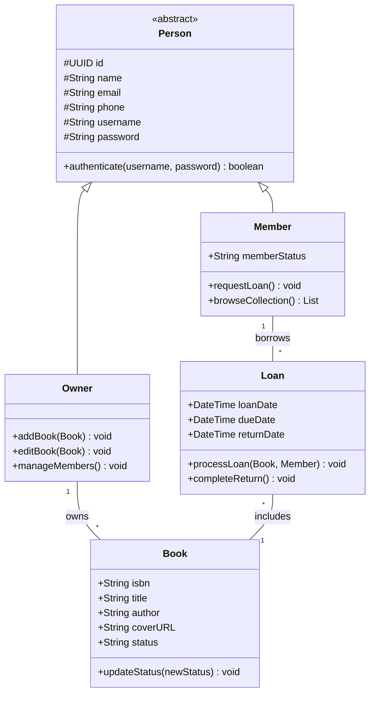

# Little Biblio — Physical Collection Management Platform

### A Web Platform for Organizing Books and Managing Loans

## Overview

**Little Biblio** is a web application designed to simplify the management of physical book collections. It helps users catalog books, track loans and returns, and maintain a clear history of their collection, reducing lost books and the friction of manual tracking.

The project focuses on validating the core domain and user experience through a functional MVP, developed with AI-assisted engineering practices.

---

## 1. The Problem

Managing physical book collections often relies on spreadsheets, handwritten notes, or scattered messages. This leads to:

- **Lost books:** Lack of reliable records makes it difficult to track who borrowed each book and when it should be returned.
- **Manual errors:** Generic spreadsheets cannot enforce business rules, such as preventing a book from being loaned to multiple people simultaneously.
- **Complex tools:** Traditional library systems can be too cumbersome for personal collections and small reading communities.

The challenge is to provide a simple, reliable way to organize books and manage their lending lifecycle.

## 2. The Solution

Little Biblio provides an intuitive platform for cataloging books and managing loans through a consistent workflow.

Key features include:

- **Book Catalog:** Register and organize books with titles, authors, ISBNs, and cover images.
- **Loan Management:** Track borrowers, loan dates, expected return dates, and completed returns.
- **Collection Search:** Find books by title, author, ISBN, or availability status.
- **Loan History:** Maintain visibility into borrowed books and their transaction history.

The MVP prioritizes core collection management and loan tracking, with a simplified administrative model to validate the product before introducing more complex multi-user features.

---

## 3. My Role: Technical Leadership and Software Engineering

As the technical lead, I guided the team throughout the project, focusing on scope definition, software architecture, and AI-assisted development.

### Technical Leadership and Scope Management

- Defined the MVP scope, prioritizing core collection management and loan workflows over nonessential features.
- Refined user stories and created a requirements traceability matrix to ensure coverage of key workflows.

### AI-Assisted Development

- Used LLMs to accelerate React component development, Pydantic schema creation, and synthetic test data generation.
- Leveraged AI to identify edge cases in loan management, including overdue returns, concurrent transactions, and dynamic filtering.

### Software Architecture and Domain Modeling

- Designed a layered architecture inspired by Clean Architecture and aligned with SOLID and DRY principles.
- Modeled relational entities in PostgreSQL and defined the object-oriented domain class diagram.

---

## 4. Software Architecture and Domain Model

The system separates domain logic, application services, and REST API endpoints to improve maintainability and support future evolution.

### Domain Class Diagram

### Requirements Traceability

| ID | User Story | Responsible Entity | Domain Operation |
|---|---|---|---|
| HU01 | Add a book to the catalog | `Owner` | `addBook(Book)` |
| HU02 | Browse the full collection | `Member` | `browseCollection()` |
| HU03 | Register a loan for an available book | `Loan` | `processLoan(Book, Member)` |
| HU04 | Register a return and update inventory | `Loan` | `completeReturn()` |
| HU05 | Search books by author, ISBN, or title | `Member` | `browseCollection()` |
| HU06 | View books currently loaned out | `Owner` | `viewLoanReport()` |
| HU07 | Manage members and contact information | `Owner` | `manageMembers()` |
| HU08 | Update book metadata | `Owner` | `editBook(Book)` |
| HU09 | Filter books by availability status | `Member` | `browseCollection()` |

---

## 5. Technology Stack

| Component | Technology | Responsibility |
|---|---|---|
| Frontend | React.js | User interface and interactive catalog |
| Backend | FastAPI (Python) | REST API and application logic |
| Database | PostgreSQL | Relational data persistence |
| Containerization | Docker & Docker Compose | Consistent development and deployment environments |

### Engineering Practices

- **Clean Architecture & SOLID:** Separation of business rules from delivery frameworks to support maintainability and independent evolution.
- **Automated Testing:** Unit tests for critical loan operations and book status transitions.
- **Modular Structure:**
  - `/src/backend`: REST endpoints, ORM mappings, business services, and schemas.
  - `/src/frontend`: UI components, hooks, and interactive tables.
  - `/docs`: Technical specifications and project documentation.
